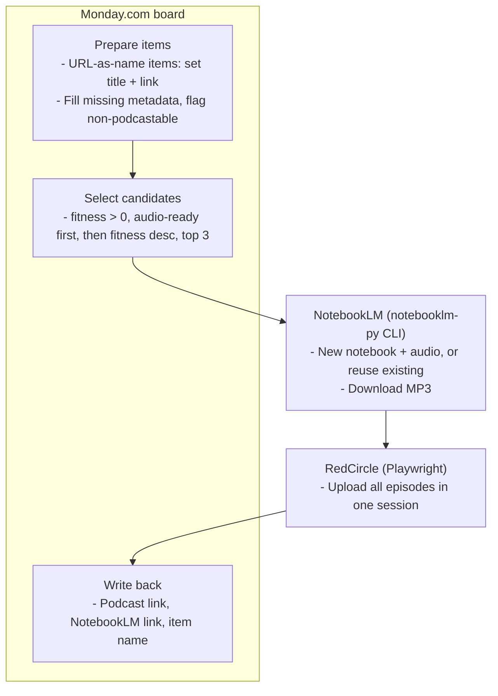

# Automated NotebookLM (Concept Prototype)

Turns articles you collect on a Monday.com board into podcast episodes: it picks the best candidates, generates audio with Google NotebookLM, uploads the MP3 to RedCircle, and writes the episode link back to the board.

> **Important:** This is a concept prototype for educational purposes. It automates interactions that may violate the Terms of Use of Google NotebookLM and RedCircle. Use it at your own risk, and review those terms first.

## How it works



- Metadata (code percentage, text length, video detection) is extracted with Cheerio; items that are mostly code or video are flagged non-podcastable.
- Items that already have a NotebookLM audio link reuse that notebook, don't count against the daily limit, and are picked before new ones.
- Errors are collected per item and reported at the end of the run; one failing item doesn't stop the others. After 3 failures for the same URL the item is marked non-podcastable.

## Requirements

- Node.js >= 24.4 and Yarn
- Python 3.10+ and [`uv`](https://docs.astral.sh/uv/) (for the `notebooklm-py` CLI)
- A Google account with NotebookLM access
- Chrome (Playwright drives it for the RedCircle upload)
- A RedCircle account with an existing podcast
- A Monday.com board and API token

## Setup

```bash
git clone https://github.com/omril321/automated-notebooklm.git
cd automated-notebooklm
yarn install

./scripts/setup-nlm.sh   # creates .venv and installs notebooklm-py
./scripts/nlm login      # Google OAuth in a browser
./scripts/nlm list       # verify

cp .env.example .env     # then fill it in
```

### Environment variables

| Variable                                 | Required | Notes                                                                   |
| ---------------------------------------- | -------- | ----------------------------------------------------------------------- |
| `MONDAY_API_TOKEN`                       | Yes      | Personal API token with read/write on the board                         |
| `MONDAY_BOARD_URL`                       | Yes      | `https://<account>.monday.com/boards/<id>` (view/filter suffix is fine) |
| `MONDAY_EXCLUDED_GROUP_IDS`              | Yes      | Comma-separated group **IDs** (e.g. your "Done" group) to skip          |
| `RED_CIRCLE_USER`, `RED_CIRCLE_PASSWORD` | Yes      | Upload runs after every successful generation                           |
| `PUBLISHED_PODCAST_NAME`                 | Yes      | Must match the podcast image `alt` text on RedCircle                    |

Google credentials are not stored in `.env`.

### Monday board

The board needs these columns; their IDs are hard-coded in [`src/monday/config.ts`](src/monday/config.ts), so edit that file to match your board.

| Column                          | Type      | Purpose                                      |
| ------------------------------- | --------- | -------------------------------------------- |
| 🔗                              | Link      | Source article URL                           |
| Type                            | Status    | Content type                                 |
| Podcast fitness                 | Formula   | Numeric score; items with `<= 0` are skipped |
| Metadata                        | Long text | Extracted metadata JSON                      |
| Non-podcastable                 | Checkbox  | Exclusion flag                               |
| Podcast link                    | Text      | Written back after upload                    |
| NotebookLM with generated audio | Link      | Written back; enables notebook reuse         |

The code only checks `fitness > 0`. To exclude already-published or non-podcastable items, make your **fitness formula return 0** for them.

## Usage

```bash
yarn generate-podcasts
```

This is a live run: it uses NotebookLM quota (about 3 new generations per rolling 24 hours), publishes episodes to RedCircle, and updates the board. Run `yarn test:run` for the test suite (no external services needed).

### Personalizing the hosts

Put instructions (max 500 characters) in [`podcast-instructions.md`](podcast-instructions.md). They apply to new generations only and are appended to the episode description. See [`prompts/podcast-instructions-guide.md`](prompts/podcast-instructions-guide.md).

### Cleaning up old NotebookLM notebooks

`src/scripts/notebookLMCleanup.js` is a DevTools snippet that deletes notebooks older than a week: open https://notebooklm.google.com/, open the browser console, paste the file's contents, and press Enter.

### Files created while running

`logs/` (rate-limit and failure tracking), `temp/` and `downloads/` (MP3s and error screenshots). All are gitignored; MP3s are not cleaned up automatically.

## Limitations

- `notebooklm-py` relies on undocumented Google APIs and may break without notice.
- RedCircle upload relies on page selectors that may break when the site changes.
- Generation takes 10-12 minutes per podcast; there are generous timeouts but no automatic retries.
- Only the top 3 candidates are considered per run, matching NotebookLM's daily limit.
- The board query fetches 500 items and throws if it gets exactly 500 (no pagination yet).
- `yarn generate-podcasts` disables TLS verification (`NODE_TLS_REJECT_UNAUTHORIZED=0`) as a corporate-proxy workaround; remove it from `package.json` if you don't need it.

## Contributing

This is a prototype, so I'm not accepting code contributions right now. I'd still love to hear about your use cases: open a GitHub issue or reach out directly.

## For AI coding agents

See [`AGENTS.md`](AGENTS.md).

## License

Apache-2.0, see [LICENSE](LICENSE).
